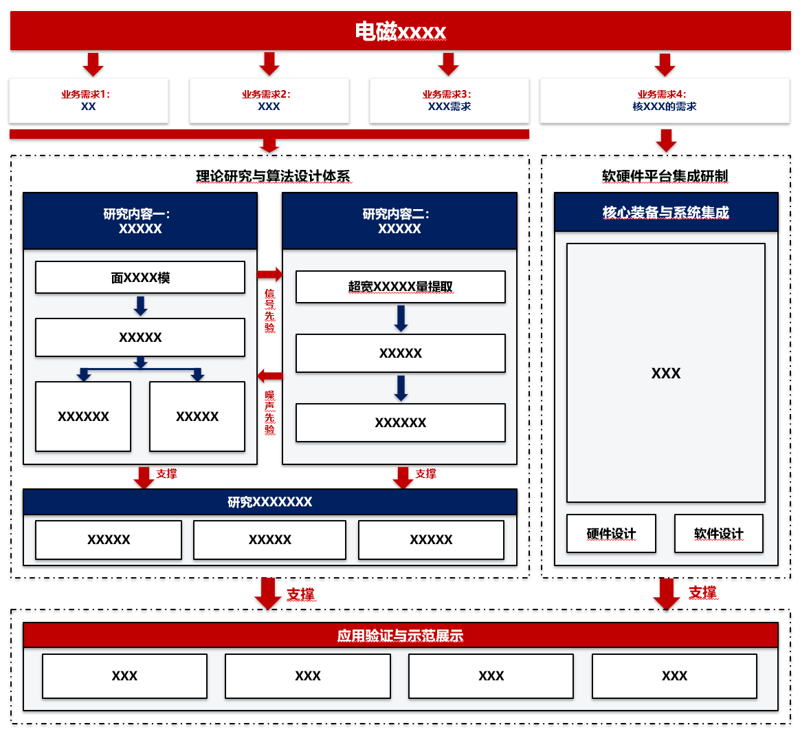
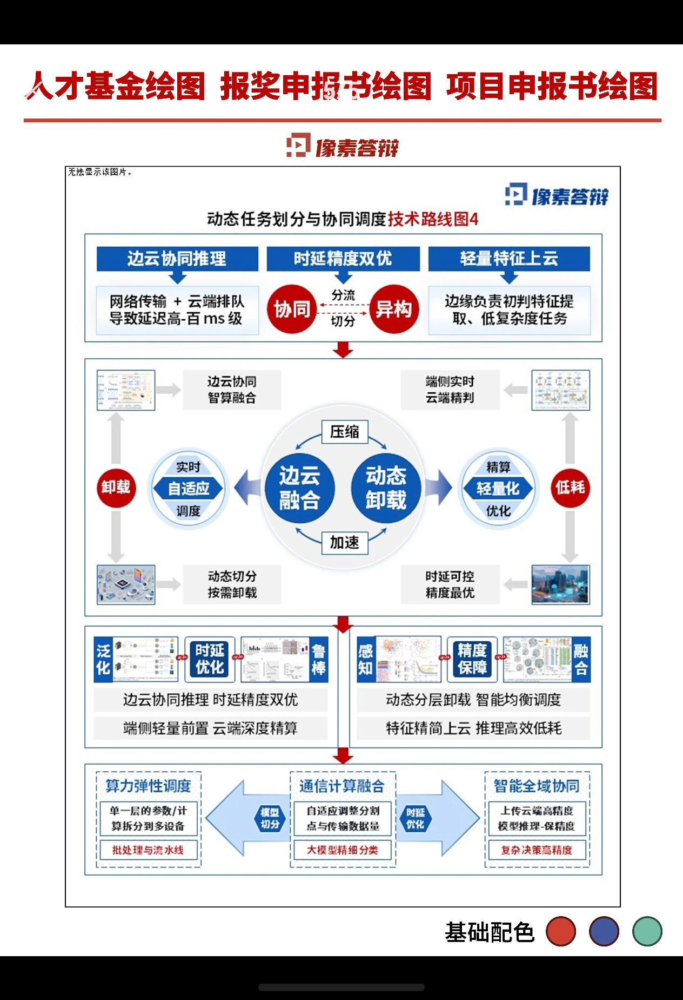
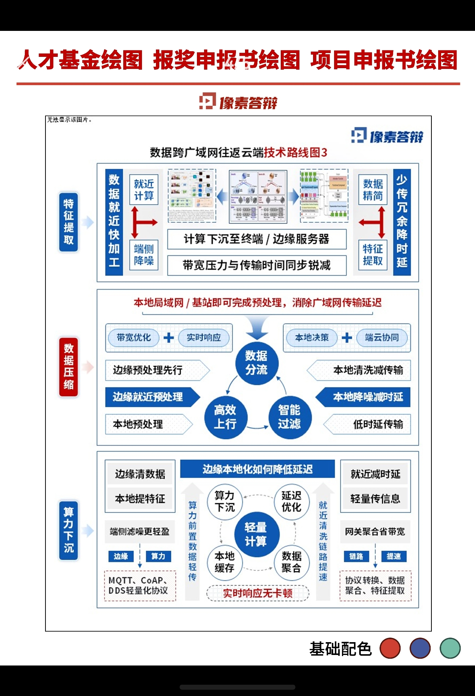
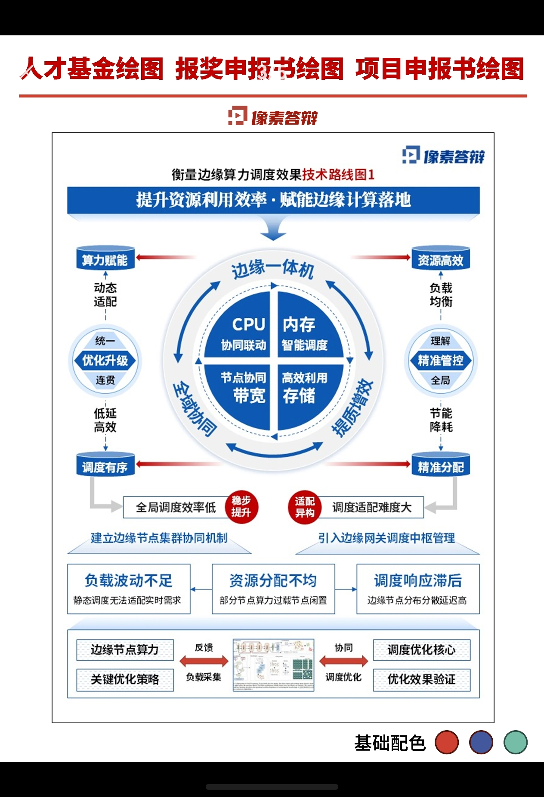
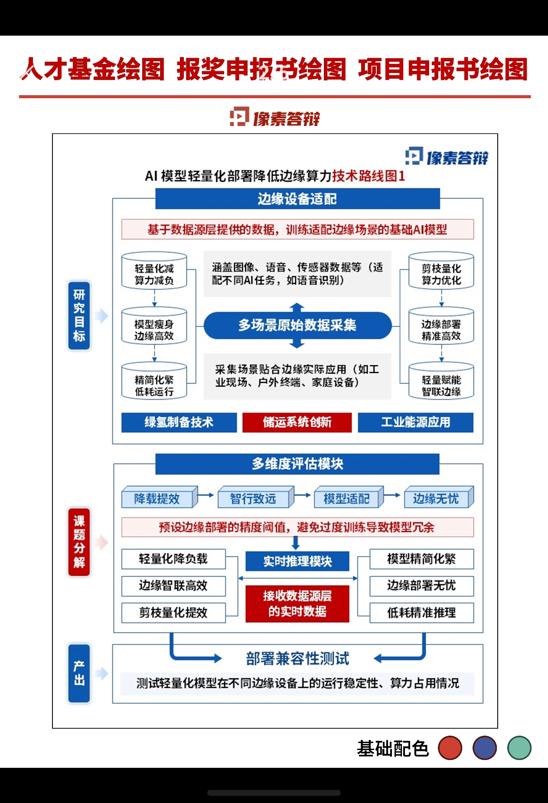
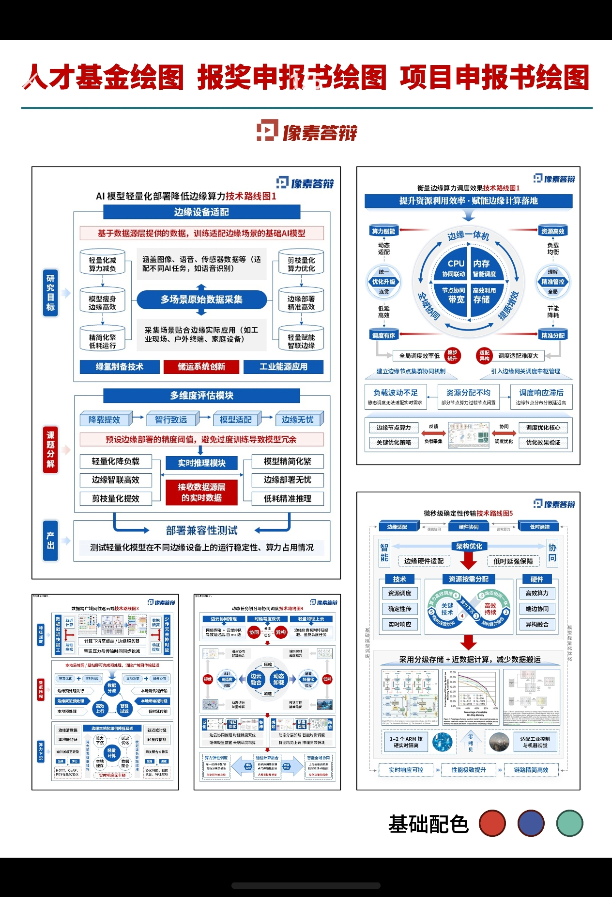

# 用 AI 把架构图变成 PPTX

| 项 | 内容 |
| :--- | :--- |
| 分享人 | 章伟杰 |
| 日期 | 2026-09-30 |
| 工具 | DeepSeek V4.1f + DSH |
| 适用场景 | 画架构图  |

## 一句话结论

截图加提示词，模型直接输出可运行的 PowerShell，生成可编辑的 PPTX。

## 场景

项目需求，画具体的架构图

## 做法

1. 找一个你喜欢的架构图存 PNG
2. 图和提示词一起丢给模型 (项目具体的内容)
3. 让它出代码
4. 粘进 PowerShell 回车；改文字就改 build_ppt.py

## 提示词

````text
# 角色
你是一名"架构图 → PPTX"的复刻工程师。你有 python-pptx 与 OOXML 底层经验。

# 任务
我给你一张架构图/流程图/中台图的**图片**。你要输出**一段 PowerShell 代码**，
我把它整段粘贴进 PowerShell 窗口、按一次回车，就能生成一个和图片几乎一模一样的
PPTX 文件，并自动用 PowerPoint 打开。我不需要保存任何文件、不需要手动装依赖。

# 交付格式（硬约束）
1. 只输出**一个** ```` ```powershell ```` 代码块，块外不要有别的代码块。
2. 代码块结构固定：
   - 头部：设置 UTF-8（[Console]::OutputEncoding / PYTHONIOENCODING）、
     查找 Python（先 python，失败再 py -3）、
     `& $py -m pip install -q --disable-pip-version-check python-pptx -i https://pypi.tuna.tsinghua.edu.cn/simple`
   - 中部：`$code = @'` … `'@` 包裹完整 Python 脚本
   - 写文件：`[IO.File]::WriteAllText($pyFile, $code, (New-Object Text.UTF8Encoding($false)))`
     ← 必须 UTF-8 **无 BOM**，否则 python 读源码报编码错
   - 执行：`& $pyExe @pyPre $pyFile $outFile`，成功后 `Invoke-Item $outFile`
   - 没有 Python 时：红字提示去 python.org 装并勾选 Add to PATH
3. **禁止出现 `exit`**（会直接关掉用户的 PowerShell 窗口），一律用 if/else 分支。
4. Python 源码里不允许出现以 `'@` 开头的行（会提前结束 here-string）。
5. 保留生成的 build_ppt.py，方便我改文字后 `python build_ppt.py` 重跑。
6. 代码块必须完整可粘贴，中间不能省略、不能用 "…" 占位。

# 复刻规则
- 单位换算：图片像素 = 设计稿像素，`100px = 1 英寸`，即 `EMU = px × 9144`；
  幻灯片尺寸 = 图片宽/100 × 图片高/100 英寸。
- 落笔前先在回复里用 3~8 行列出**坐标表**：每个色块的
  (x, y, w, h, 填充色, 边框色, 圆角, 文字, 字号, 字色)，我核对完再写代码。
- **逐块还原，一块都不许漏**：每个矩形、胶囊、箭头、虚线框、竖排文字、云朵装饰
  都要有对应形状；层级顺序 = 背景 → 容器 → 子块 → 文字。
- 取色：按视觉取 6 位十六进制，同一色系内部保持一致（如所有"浅蓝底"用同一个值）。
- 圆角：小胶囊 rad≈0.20~0.25，大容器 rad≈0.03~0.08，直角块用 `sq()`。
- 特殊元素近似法：
  虚线框 = 边框 dash_style；竖排文字 = 文本框 rotation=90（先按横排尺寸居中摆好再转）；
  云朵/装饰 = 大圆角矩形 rad=0.5；块箭头 = DOWN_ARROW / RIGHT_ARROW / LEFT_ARROW。

# 字号与排版铁律
- 字号经验值：容器标题 10pt，普通标签 8~9pt，**最低 7.5pt**，再小就糊了。
- 中文单字宽度 ≈ 字号(pt) × 1.39 px（在 100px/英寸 下）；
  要求 **框宽 ≥ 字数 × 字号 × 1.39 × 1.15**（留 15% 余量），不够就加宽框或降字号。
- 所有文本 `word_wrap = False`（防止意外折行），水平居中、四边 margin 设 0。
- 文字必须显式设置 `font.name` 且补 `a:ea` / `a:cs = 微软雅黑`，否则中文可能回退成宋体。

# 致命坑
1. ★★★ `RGBColor` 是 `tuple` 的子类！**绝对不能**用 `isinstance(fill, (tuple, list))`
   判断"是不是渐变色"。这个 bug 会让**所有纯色**生成非法 XML（如 `val="255"`），
   PowerPoint 解析失败后整张图回退成主题默认色（深绿底 + 白字），画面直接报废。
   纯色只能走 `sh.fill.solid(); sh.fill.fore_color.rgb = fill`，并在入口加
   `assert isinstance(fill, RGBColor)`。
2. 手写 XML 时单位：颜色必须 6 位十六进制；角度用 1/60000 度（90° = 5400000）；
   EMU = pt × 12700；透明度 alpha = 百分比 × 1000。
3. 每个形状都要**显式**设置填充与描边状态：`line=None` 时必须
   `sh.line.fill.background()`，否则会继承主题描边。
4. 每个形状创建后立即 `strip_style(sh)` 移除 `<p:style>`；
   并统一 `no_shadow()`（写空 `<a:effectLst/>`）或 `add_shadow()`，二选一，不能不管。
5. `sh.shadow.inherit = False` 在早期 0.6.x 没有这个属性；新版本等价于写空 `<a:effectLst/>`。为了跨版本一致，统一用 `no_shadow()`。
6. 文字宁可加宽框，也不许压边框；出现溢出就是尺寸算错了，回去重算。

# 必须使用的代码骨架（照抄，不要自己重写）
```python
def C(h): return RGBColor(int(h[0:2],16), int(h[2:4],16), int(h[4:6],16))
def PX(v): return Emu(int(round(v * 9144)))          # 100px = 1in

def _sp(sh): return sh._element.spPr
def _drop(sp, tags):
    for t in tags:
        e = sp.find(qn(t))
        if e is not None: sp.remove(e)
def strip_style(sh):
    e = sh._element.find(qn('p:style'))
    if e is not None: sh._element.remove(e)
def set_fill(sh, fill):                              # ★ 只收 RGBColor / None
    if fill is None: sh.fill.background()
    else:
        assert isinstance(fill, RGBColor), fill
        sh.fill.solid(); sh.fill.fore_color.rgb = fill
def no_shadow(sh):
    sp = _sp(sh); _drop(sp, ('a:effectLst','a:effectDag'))
    sp.append(parse_xml('<a:effectLst xmlns:a="...main"/>'))
def add_shadow(sh, blur=5, dist=2.5, ang=90, alpha=20, color="0B1B33"):
    sp = _sp(sh); _drop(sp, ('a:effectLst','a:effectDag'))
    sp.append(parse_xml('<a:effectLst xmlns:a="...main"><a:outerShdw blurRad="%d" '
        'dist="%d" dir="%d" rotWithShape="0"><a:srgbClr val="%s"><a:alpha val="%d"/>'
        '</a:srgbClr></a:outerShdw></a:effectLst>'
        % (blur*12700, dist*12700, ang*60000, color, alpha*1000)))
def put(sh, lines, size=8.5, color=BLK, bold=False, align=CENTER, sp=1.0):
    # word_wrap=False；每行可用 "文本" 或 (文本, 字号, 颜色, 加粗)；
    # 每个 run 补 a:ea / a:cs = 微软雅黑
def rr(x,y,w,h, fill=WHT, line=None, lw=0.75, txt=None, size=8.5, color=BLK,
       bold=False, rad=0.15, kind=None, rot=0, shd=None, **kw):
    # ROUNDED_RECTANGLE + adjustments[0]=rad；strip_style → set_fill →
    # line(None 则 background()) → no_shadow/add_shadow → put(文字)
def sq(x,y,w,h,**kw): kw['rad'] = 0; return rr(x,y,w,h,**kw)      # 直角
def tx(x,y,w,h,txt,...)      # 纯文本框
def vtx(cx,cy,span,txt,...)  # 竖排：tx(...) 后 rotation = 90
```

# 交付前自检清单（逐条核对后再输出）
- [ ] 幻灯片尺寸 = 图片宽高 / 100 英寸
- [ ] 所有填充值都是 RGBColor（没有 tuple / 字符串混进去）
- [ ] 每个形状都有显式 fill + line 状态 + shadow 状态
- [ ] 所有中文都走微软雅黑（含 ea/cs）
- [ ] 没有任何 `exit`、没有任何 `'@` 开头的行
- [ ] 长中文标签都用 1.15 余量校验过框宽
- [ ] 与图片逐块比对，确认没有漏块、没有错位
- [ ] 生成后自动打开，且保留 build_ppt.py

# 交互协议
- 图片过小、文字看不清时，**先列出不确定项并问我**，不许瞎猜。
- 每次输出代码前，先用简短小结说明你识别到的区块与配色，方便我核对。
- 我回复"某某处不对 + 截图"时，只改对应坐标/颜色，其余不动，
  并且依旧输出**完整可粘贴的整段代码**（不要只给 diff）。

# 本次参数（填空）
- 输出文件名：数据中台架构图.pptx
- 阴影：关闭（保持原图扁平风）
- 其他：无
````

## 效果



形状都是独立的，改得动。

## 踩坑

1. 暂无

## 复用建议

平时多保存一些架构图，image里面包含了一些我收藏的架构图

## 参考架构图






