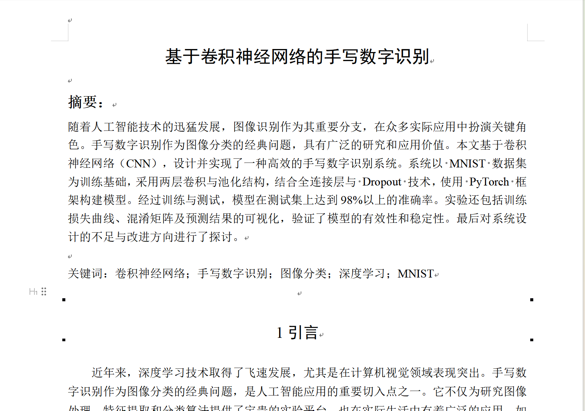
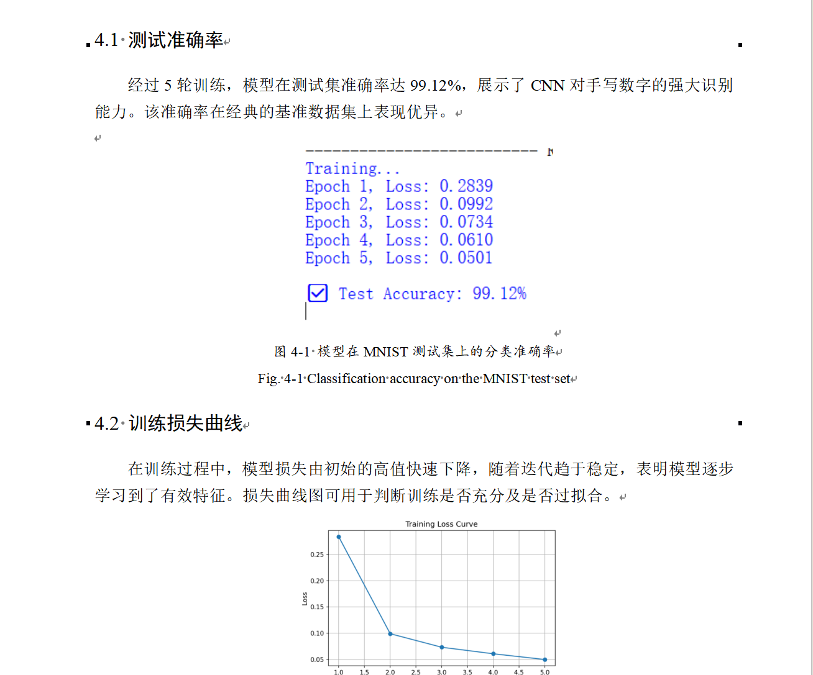
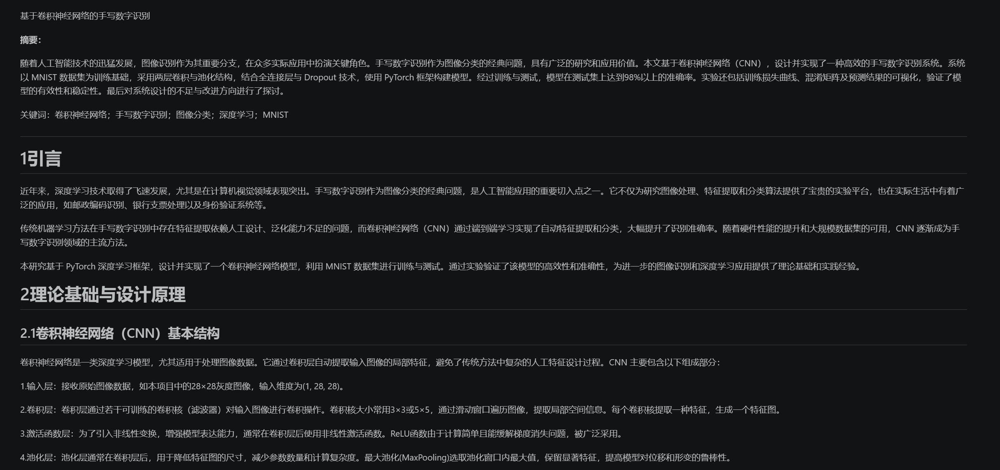
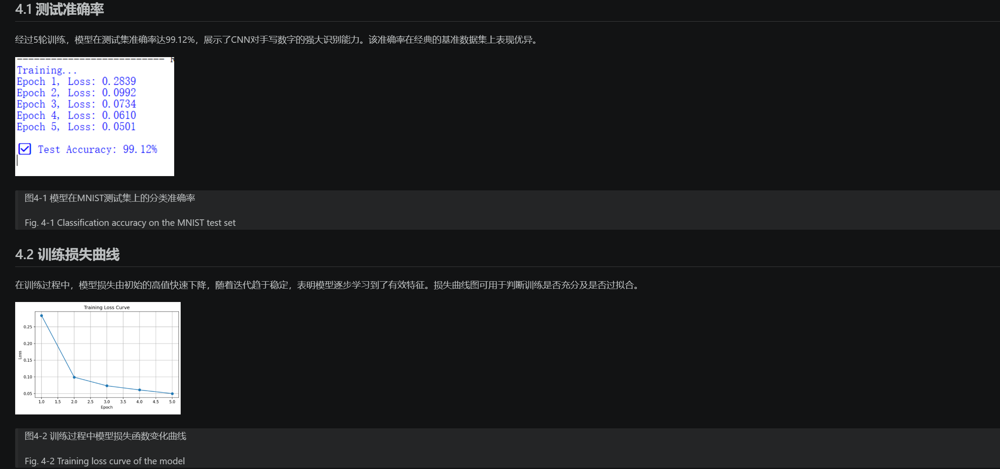

# 用 Pandoc 一条命令把 Word 转成 Markdown

| 项 | 内容 |
|---|---|
| 分享人 | 张浩 |
| 日期 | 2026-10-26 |
| 工具 | Pandoc 3.12.1（免费开源，单文件离线运行） |
| 适用场景 | 组会材料 / 论文初稿 / 调研报告转 Markdown，喂 AI、进知识库、记笔记 |

## 一句话结论

Word 转 Markdown 别手动整理，一条 Pandoc 命令 10 秒搞定：标题、列表、表格、图片全保留，转出来的文件夹整体拷走图片不丢。

## 场景

导师或同学发来一堆 `.docx`（论文初稿、调研报告、写作指令），想喂给大模型、放进知识库或者转成笔记——直接复制粘贴格式全乱，手动整理半小时起步，图片还得一张张另存。

先说清楚边界：虽然也支持 Markdown 转 Word ，但是转后的格式混乱，不建议使用； 要保真复刻 Word 排版的 PDF，用 WPS/Word 的"另存为 PDF"，别用 Pandoc；PDF 转任何格式都不支持，因为Pandoc不读 PDF。

## 做法

1. 安装 Pandoc：便携版解压到 `D:\Pandoc` 即用（安装方法见提示词）
2. 在 PowerShell / CMD 里先 `cd` 进目标文件夹，再跑一条命令：

   ```powershell
   D:\Pandoc\pandoc-3.12.1\pandoc.exe 文档名.docx -o 文档名.md -t gfm --extract-media=.
   ```

3. 跑完当前文件夹出现 `文档名.md` + `media\` 图片文件夹，md 里图片是相对路径引用，整个文件夹拖到哪里都不会丢


## 提示词

不想记命令的，装了任意 agent（Codex / Claude Code / WorkBuddy）直接粘这两段：

安装 Pandoc：

```
帮我安装 Pandoc 最新版到 D:\Pandoc：
从 https://github.com/jgm/pandoc/releases 下载 Windows x86_64 便携版 zip，
国内网络直连不通就用 ghfast.top 镜像前缀加速，
下载后解压到 D:\Pandoc，最后运行 pandoc --version 验证。
```

借助agent使用Pandoc：

```
把 "D:\缓存\xxx.docx" 转成 Markdown：cd 进该文件夹，
用 pandoc.exe 文档名.docx -o 文档名.md -t gfm --extract-media=. 转换，
图片放 media 子文件夹用相对路径引用，转完检查图片引用和文件一一对应。
```

## 效果

Word 里排版复杂的原文档：




一条命令后，Markdown 编辑器里的效果（结构、图片全在）：




实测：一份 35 KB 带图 docx 转换约 1 秒，比用 agent 转化重写要快；转出的 md 喂大模型比贴 Word 纯文本更省 token。

## 踩坑

1. **转换成功时静默无输出**——pandoc 不打印"成功"，需要去目录里看有没有生成 `.md`
2. **文件名混入空格**——中文输入法下复制长命令，`指令 .docx` 一混空格就找不到文件。对策：先 `cd` 进目录用短文件名
3. **md 转回 Word 图片丢失**——`-t gfm` 生成的 `` 标签回转时会被丢弃，需先替换成 `` 语法

## 复用建议

- 命令模板通用：任何 Word/带图文档换成文件名即可，建议保存成备忘
- 组里常收 md 材料的场景都适用：开题报告、调研报告、写作指令合集；转完统一进知识库/喂 AI，格式统一省心
