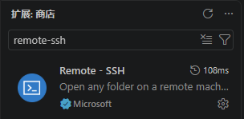
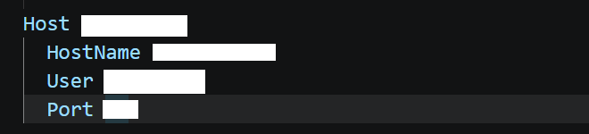
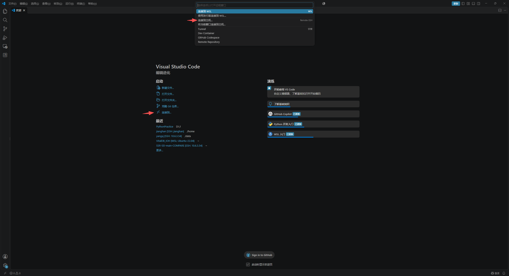

# 用 VS Code 远程连接服务器

| 项 | 内容 |
| :--- | :--- |
| 分享人 | 杨兴杰 |
| 日期 | 2026-11-05 |
| 工具 | VS Code、Remote - SSH |
| 适用场景 | 服务器代码编辑、实验运行、远程项目管理 |

## 一句话结论

使用 VS Code 的 Remote - SSH 扩展连接服务器后，可以直接打开远程工作目录、编辑代码并运行终端；配置或连接遇到问题时，可以让 AI 根据脱敏信息辅助排查。

## 场景

代码和实验环境放在服务器上，希望在 VS Code 中完成文件浏览、代码修改和命令执行，同时减少反复切换工具的操作。

首次连接时，容易混淆主机名称、服务器地址、登录用户名和 SSH 端口，也可能遇到网络不通、认证失败或远程环境初始化缓慢等问题。把连接流程整理成固定步骤，再配合明确的排错提示词，方便后续复用。

## 做法

1. **准备连接信息。** 确认服务器地址、登录用户名、SSH 端口和认证方式，并确保网络能够访问服务器。如果服务器仅允许校园网或内网访问，需要先接入相应网络或 VPN。

2. **安装扩展。** 在 VS Code 的扩展页面搜索 `Remote - SSH`，安装 Microsoft 发布的扩展。使用前还需具备可用的 SSH 客户端。

   

3. **添加 SSH 主机。** 在命令面板中运行 `Remote-SSH: Open SSH Configuration File...`，选择配置文件，加入下方配置。将尖括号占位符替换为实际信息后保存。

   

4. **发起连接。** 运行 `Remote-SSH: Connect to Host...`，选择配置中的主机别名。如提示选择操作系统，按服务器实际系统选择；Linux 服务器选择 `Linux`。使用密码认证时，按提示输入密码。

   也可以在欢迎页点击“连接到…”，再选择“连接到主机…”，如下图所示。

   

5. **等待初始化。** 首次连接需要安装并启动 VS Code Server。连接成功后，左下角会显示远程连接标识和主机名称。

6. **打开工作目录。** 点击“文件”→“打开文件夹”，选择服务器上的项目目录。此时可在资源管理器中浏览远程文件，在该远程窗口中新建的终端中运行服务器上的命令。

SSH 配置示例：

```sshconfig
Host research-server
    HostName <服务器地址>
    User <登录用户名>
    Port <SSH端口>
```

| 字段 | 填写内容 |
| :--- | :--- |
| `Host` | 自定义连接别名，例如 `research-server` |
| `HostName` | 服务器 IP 地址或域名 |
| `User` | 服务器登录用户名 |
| `Port` | 管理员提供的 SSH 端口 |

### 提示词

以下提示词可用于辅助配置与排错，填写已有信息即可：

```text
我想用 VS Code 的 Remote - SSH 连接服务器，请根据以下信息指导我完成配置，并在连接失败时帮助排查。

服务器系统：<已知系统；不确定则写“不确定”>
网络要求：<公网 / 校园网 / VPN / 不确定>
认证方式：<密码 / 密钥 / 不确定>
SSH 配置：<粘贴脱敏后的 Host、HostName、User、Port 配置>
当前进度：<尚未配置 / 已添加主机 / 连接失败 / 已连接但无法打开目录>
报错信息：<粘贴脱敏后的相关日志；没有则写“无”>

请按以下要求回答：
1. 信息不足时先指出缺少什么，不要猜测服务器地址、用户名或端口。
2. 如果尚未配置，给出需要替换占位符的 SSH 配置示例和 VS Code 操作步骤。
3. 如果连接失败，按网络可达性、SSH 配置、身份认证、VS Code Server 初始化的顺序排查，每一步说明应观察什么结果。
4. 区分已确认的原因和仍需验证的可能原因。
5. 不要索要密码、私钥内容或验证码。
```

## 效果

连接成功后的操作方式可以从以下方面确认：

| 操作 | 连接前 | 连接成功并打开远程目录后 |
| :--- | :--- | :--- |
| 浏览项目 | 尚未在 VS Code 中打开服务器项目 | 资源管理器显示远程项目文件 |
| 修改代码 | 需要先取得远程文件或使用其他工具 | 可直接打开、编辑并保存远程文件 |
| 执行命令 | 需要另行建立服务器终端会话 | 可在远程窗口中新建终端运行命令 |
| 确认连接状态 | 尚未进入远程会话 | 左下角显示远程连接标识和主机名称 |

以上是连接成功后的检查项，可在实际连接时逐项确认。

## 踩坑

下表列出常见现象及排查方向，具体原因需要结合日志确认。

| 现象 | 排查方向 |
| :--- | :--- |
| 连接超时或一直无响应 | 确认是否已接入要求的网络或 VPN，再核对服务器地址与端口 |
| 主机已添加，但无法连接 | 检查 `HostName`、`User`、`Port` 是否正确，是否仍有未替换的占位符 |
| 提示认证失败 | 确认登录账号、密码或密钥是否与服务器要求一致 |
| 服务器平台选择错误 | 按服务器实际操作系统修正选择，不能一律选择 Linux |
| 停留在 VS Code Server 初始化阶段 | 查看 `Remote - SSH` 输出日志，确认失败发生在哪一步 |
| 连接成功但没有显示项目文件 | 通过“文件”→“打开文件夹”选择远程工作目录 |

## 复用建议

- **为每台服务器设置清晰的别名。** 后续从主机列表选择对应名称即可发起连接。
- **保留通用配置模板。** 连接新服务器时，逐项填写地址、用户名、端口和认证要求。
- **向 AI 提供当前进度和具体报错。** 比起只说“连不上”，相关日志更有助于判断问题发生在哪一步；分享前先脱敏。
- **连接后先确认工作位置。** 检查远程标识、打开的项目目录和新建终端所在环境，再执行项目操作。

参考：[VS Code Remote - SSH 官方文档](https://code.visualstudio.com/docs/remote/ssh)。
