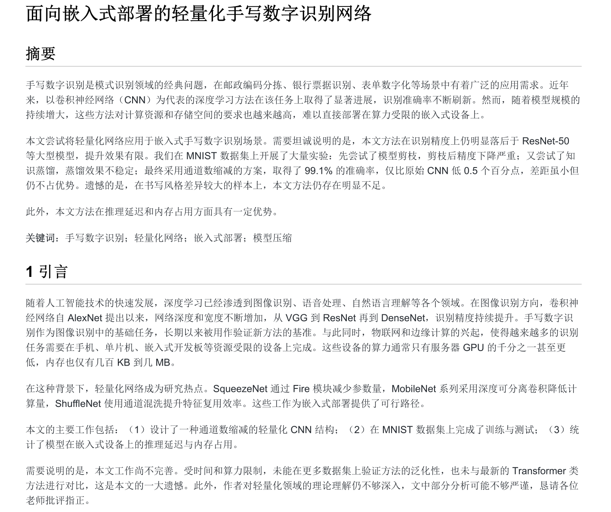
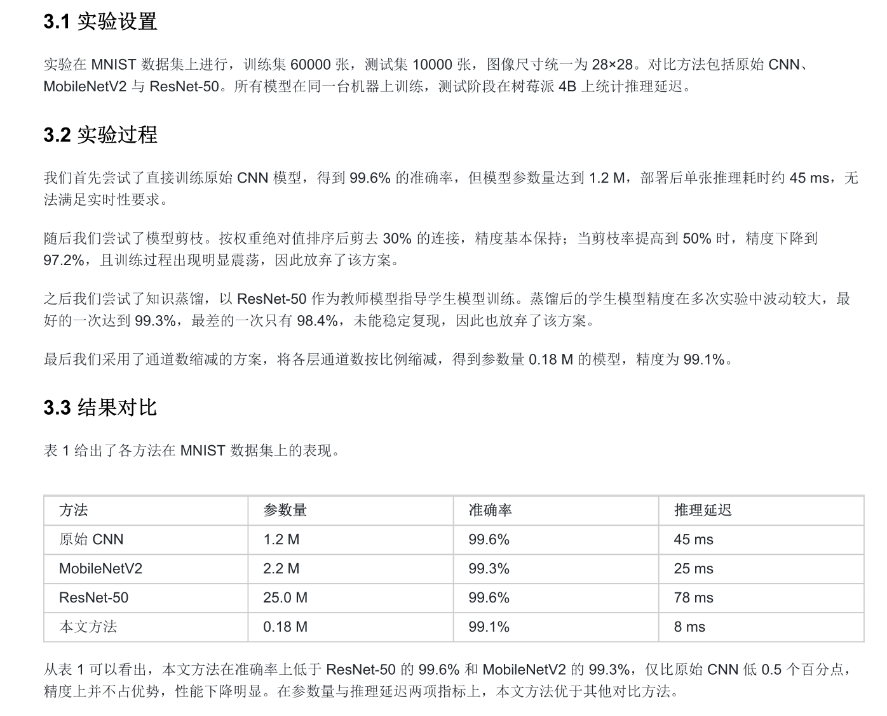
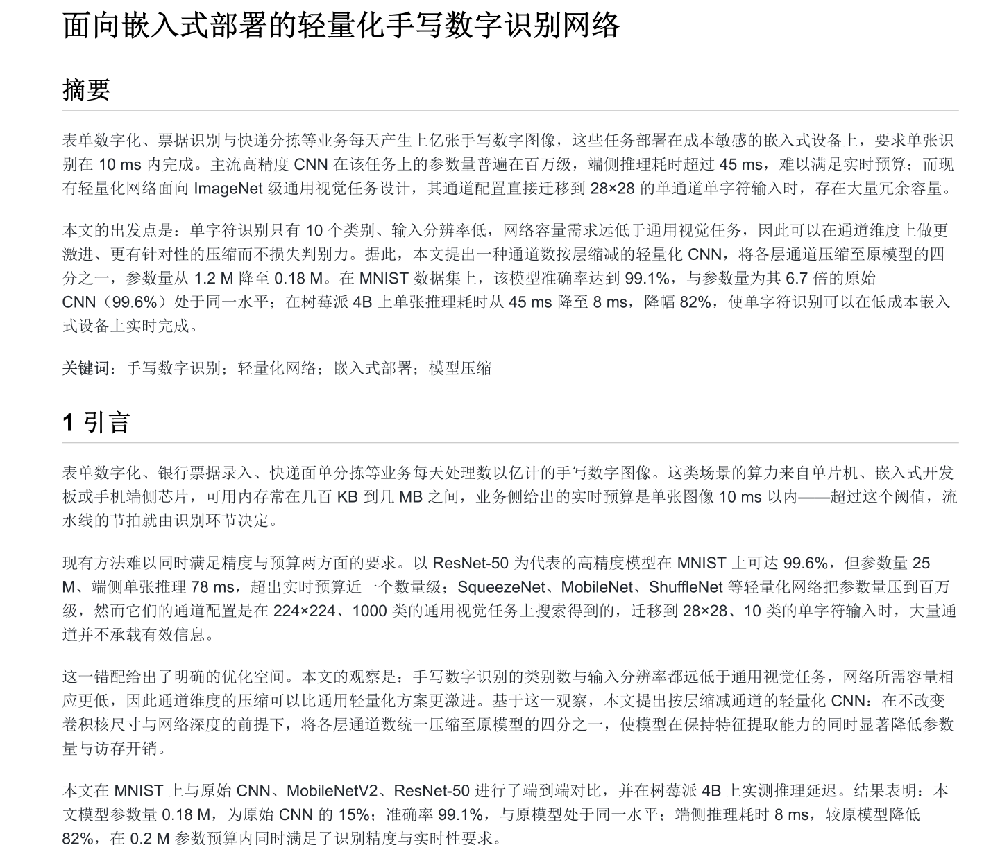
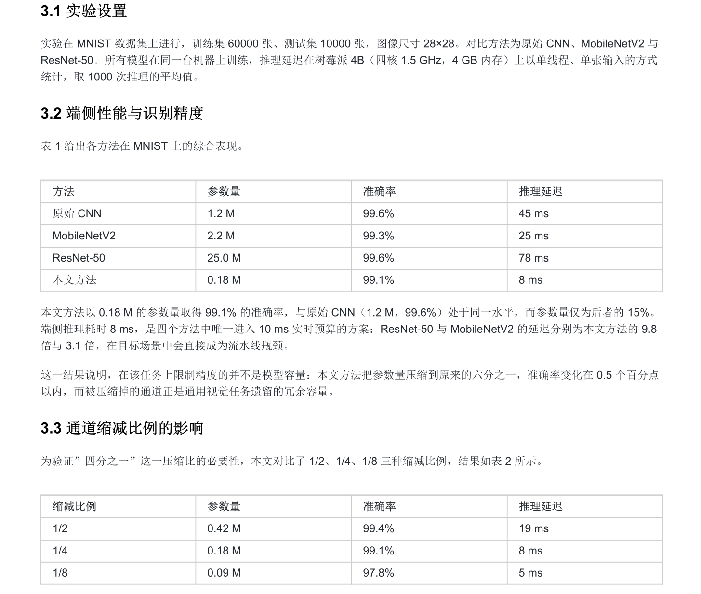

# 用 anti-defensive-writing 改掉论文的防御性写作

| 项 | 内容 |
|---|---|
| 分享人 | 张浩 |
| 日期 | 2026-11-05 |
| 工具 | anti-defensive-writing（Agent Skill） |
| 适用场景 | 写摘要与引言 / 改结论 / 压缩论文 / 组织实验章节  |

## 一句话结论

论文是学术发布会，不是项目总结和实验日志——这个 skill 用一套可核对的规则，阻止你在稿子里主动示弱、写实验流水账、把不占优的指标设成主战场，等于不给审稿人递刀。

## 场景

写论文最伤稿子的往往不是语法错误，而是叙事上的自我拆台：摘要先铺三段背景，贡献还没立起来就先声明本文方法仍有不足；实验章节写成"先试了 A，A 不行又试了 B"的流水账；不占优的指标偏偏摆到主表第一列；结论最后一段突然补一句局限。审稿人抓的这些点，很多是作者自己主动递上去的。

这个 skill 就是针对这件事：把论文当成一场学术发布会来组织，先找出这项工作真正领先、独特、不可替代的部分，再围绕它建立最有利、最完整、最有说服力的叙事。具体管四块：

- **叙事**：只围绕优势组织论文，不写成工作汇报，打不过的维度不设为比赛项目，允许彻底重构故事
- **语言**：禁用"遗憾的是""仅""仍明显落后""效果有限"这类自我削弱表达，不主动说输
- **实验**：每个实验必须承担明确论证职责（证明方法有效 / 证明优势来自关键机制 / 证明场景价值 / 排除替代解释），无关的实验删除或重组
- **结构**：摘要和引言迅速立住四件事（问题重要 / 现有缺口 / 本文思路 / 最有力结果），结论只强化记忆点，不突然自我否定

## 做法

1. 安装 skill（安装方法在提示词）
2. 用自然语言触发，不必记命令，直接说"用 anti-defensive-writing 帮我改摘要和引言"即可
3. 它会按七条默认决策规则处理不理想材料：删除无关内容 → 缩小主张 → 换评价维度 → 解释为合理权衡 → 重组实验 → 重定义故事 → 万不得已才做必要说明
4. 交稿前跑一遍它的自查清单，确认没有"主动扩大攻击面"的句子

## 提示词

安装并启用：

```
帮我把 anti-defensive-writing 这个 skill 装到用户级技能目录，
仓库地址：https://github.com/Adkid-Zephyr/anti-defensive-writing-Skill
装完确认能被识别，之后我说"论文润色""rebuttal""防御性写作"时自动触发。
```

实际使用（改稿场景）：

```
用 anti-defensive-writing 帮我改这篇论文的摘要和引言：
先告诉我这篇工作最值得发表的优势是什么，再按"问题重要 → 现有方法缺口 →
本文新解法 → 最有力证据"重排叙事，把自我削弱的表述（遗憾的是/仅/效果有限/
存在严重不足）全部标出来给我看不改，最后给一个改后版本。
我的论文：<xx\xx>
```


## 效果

改前：摘要先铺背景、贡献没立起来就自陈不足，实验章节按"我们尝试了什么"的顺序展开：




改后：开场四件事（问题重要 / 现有缺口 / 本文思路 / 最有力结果）迅速立住，实验按"证明什么"组织而不是按"做了什么"排列：




## 踩坑

1. **它不是语法检查器**——别指望它改错别字、修公式、排参考文献，那些得用别的工具；它的产出是"叙事判断 + 改后段落"，不是逐句校订
2. **会删掉你的弱项，但有些弱项删不得**——伦理声明、数据合规、方法适用边界属于"必须说明"，不在"不主动示弱"的范围内，改完必须人工过一遍，别整篇无脑接受
3. **"不说输"≠"编造赢"**——收缩主张、换评价维度是允许的，把没跑过的实验写成跑过、把 0.5% 的提升说成显著，就是学术不端，红线
4. **触发词要用对**——说"帮我看看这段写得怎么样"它可能不加载；要用"论文润色 / 改摘要 / 压缩论文 / 防御性写作"这类词

## 复用建议

1. 把它的"交稿前自查 8 问"抄进自己的投稿 checklist，比每次重新跑 agent 更省时间
2. 组里投期刊/会议的稿子都适用，尤其适合"结果不算惊艳但工作扎实"的情况——这类工作最容易被自己写废
